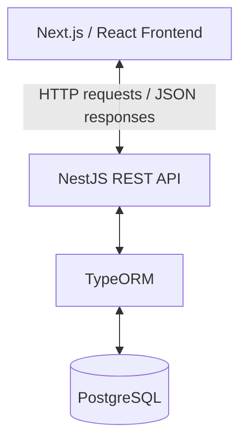
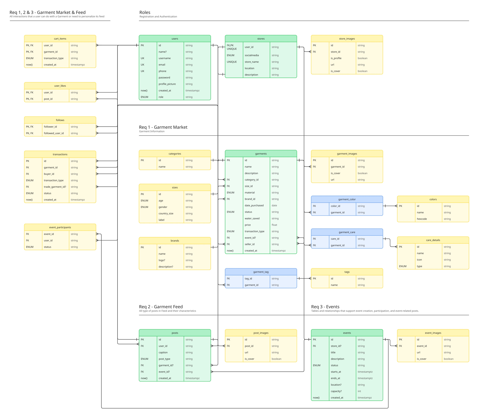
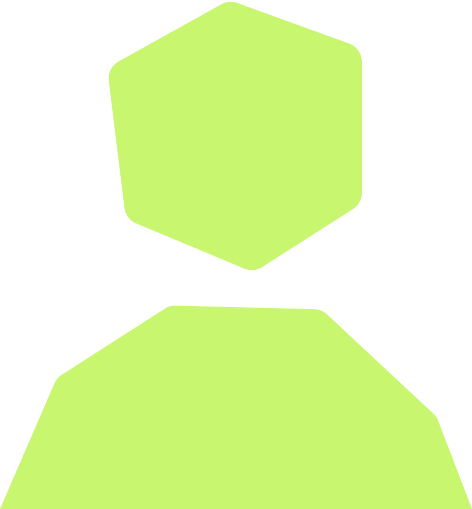

<p align="center">
  
</p>

<div>

<h3 align="center"><em> "Retagging the way you treat your Garments."</em></h3>

</div>

<p align="center">
  <strong>
ReTag is a full-stack university project with the philosophy of serving as a digital platform that drives the growth of circular fashion. We are currently working with Nest.js, Next.js, TypeORM, and a PostgreSQL database to provide industry-level technology that ensures the project’s goals are met.
</strong><br>

</p>

</br>
  <p align="center">
    <a href="#deployment"><strong>View Demo</strong></a>
    &middot;
    <a href="https://github.com/alejmmtz/ReTag-App/issues/new?labels=bug&template=bug-report---.md"><strong>Report Bug</strong></a>

  </p>
</br>

<div align="center">


</div>

</br>

## Table of Contents

- [Table of Contents](#table-of-contents)
- [About the Project](#about-the-project)
- [Our Main Features](#our-main-features)
- [Architecture](#architecture)
  - [Frontend–Backend Integration](#frontendbackend-integration)
  - [Architecture Diagram](#architecture-diagram)
  - [Backend Modules](#backend-modules)
- [Frontend Structure](#frontend-structure)
- [Authentication & Authorization](#authentication--authorization)
- [UI States & Error Handling](#ui-states--error-handling)
- [Database Model](#database-model)
- [Installation](#installation)
  - [Prerequisites](#prerequisites)
  - [NestJs Settings](#nestjs-settings)
  - [Setup](#setup)
  - [Frontend Setup](#frontend-setup)
  - [Environment Configuration](#environment-configuration)
  - [Running the Project](#running-the-project)
- [API Reference](#api-reference)
- [Development](#development)
- [Testing](#testing)
- [Challenges & Decisions](#challenges--decisions)
- [Deployment](#deployment)
- [Demo Credentials](#demo-credentials)
- [Our Team](#our-team)
  
</br>

## About the Project

</br>

<p align="center">
  
</p>

<p>
As fashion enthusiasts, we love new trends and solutions to the excessive waste caused by the modern industry. And it’s a priority for us to give these vital elements of healing such as circular fashion, the visibility they need to take off and become part of everyday life. At ReTag, we focus precisely on that, providing a platform and a consistent, conscious push. Because we need to learn to take things more slowly and start embracing a world of alternatives to conventional clothing purchases.

Currently, there are multiple physical and digital channels to meet this demand, including flea markets, specialty stores, online platforms, and apps. However, current apps present critical problems that limit the adoption of circular fashion, hinder transactions, and place a heavy cognitive burden on users.

ReTag will build an ecosystem rather than offering just a single, one-off feature. It will address gaps in interactivity, transactional capabilities, and security by providing an experience that is low-cognitive-load for the seller and highly engaging for the buyer. It will redefine the concept of traditional e-commerce by merging physical, hybrid, and virtual environments through dynamic scrolling, innovative garment presentations, and flexible exchange options, transforming the way secondhand clothing is sold and purchased.

Finally, at ReTag, we aim to provide the best user experience. We incorporate our eco-friendly philosophy into every aspect of our app and proudly exclude technologies such as artificial intelligence from our experience, because beauty comes from human driven community. Join us, were we can help reduce our impact on the planet while enjoying our shared passion for dressing well.</p>

</br>

## Our Main Features

- **Feature 1 - ReTag Market**: Offering, selling, trading, and buying secondhand clothing.
  - **For Offers:** Allows for detailed description of the item, reduces the cognitive load of describing it, offers autocomplete options, automatically calculates information about the item, tracks relevant statistics, provides an organized view of all listed products and their options, features a dashboard with insights, and includes a transactional mode.
  - **For sales:** Tracking of sales progress for both buyer and seller, options to contact the seller, a customer support menu, positive messages that reinforce the purchase, and a sales funnel mockup.
  - **For exchanges:** Option to have an exchange menu where features are compared so the user can determine whether the trade-in is worthwhile and what it entails; as if it were a personal experience, it can include background music and a progress bar.
  - **For purchases:** Order tracking for the buyer; the ability to view posts and their content; product statistics relevant to the buyer; information about the brand being purchased (if it’s in the database) and its history, finally the environmental impact of the purchase.
    </br></br>

- **Feature 2 - Social Feed**: In the app, we’ll manage a social media feed that hosts different types of posts, including:
  - **Show Off Posts:** Related to Garments purchased by users who later show them off on the app, thereby increasing the visibility and completeness of the transactions.
  - **Community Posts:** Related to progress in our advocacy for circular fashion and the environment, where users can promote an eco-friendly lifestyle through community efforts.
  - **Offer Posts:** Offers from Garment sellers in post format to increase product visibility and secure a spot in the app's feed.
  - **Event Posts:** Related to events hosted by clothing stores and the app used to invite the community to a specific gathering based on shared interests and goals.

  All posts can have likes, captions, and creation dates, and can be viewed later from the user’s profile.

  In addition to the main feed, there’s a horizontal Reels-style search feed where you can view Garments on offer using a pseudo-algorithm. And, of course, there’s also the product search tab with a filter search bar.
  </br></br>

- **Feature 3 - Events at ReTag:** It allows users to discover, participate in, and share events related to circular fashion, promoting interaction and a sense of community.

  And it gives every verified store the opportunity to create an event for its followers, with the goal of bringing the entire community together and establishing the hybrid connection that is central to our business model.

  There are two types of events:
  - **In-person:** In-person events are invitations to local events in which ReTag continues to participate, but only as an invitation platform.
  - **Virtual:** While virtual events are often hosted by us, where users can upload their clothing and offer content based on the proposed theme.
    </br></br>

- **Feature 4 - Who Are You? On Another Level**: At ReTag, we take your identity and your participation in our platform very seriously. We want both users and stores to be able to take control of their content and sales to the next level. Furthermore, our main goal is for our app to foster a constant sense of community where each of us feels the importance of our role in the project. We provide personalized support and tailor your experience to your needs.

</br>

## Architecture

- **Server Side**: Our backend is being built using the **_Nest.js_** framework. We follow modular organization practices and map database entities using **_TypeORM_**.
- **Client Side**: Our front end is being built using **_Next.js_** and **_React_** to create a modern, user-friendly, and high-performance UI.
- **Database**: Thanks to **_PostgreSQL_**, we can create a robust and comprehensive relational database that allows us to provide users with all the information they need for their experience.

### Frontend–Backend Integration

ReTag uses a full-stack architecture that separates the user interface, the application logic and the database. The Next.js frontend communicates with the NestJS backend through a REST API, while TypeORM manages access to PostgreSQL.



When a user performs an action, the frontend sends a request to the API. The backend validates the request and the applicable permissions, executes the corresponding business rules, and interacts with the database when necessary. The response is then used to update the interface.

### Architecture Diagram

A request in the ReTag backend follows a structure similar to:

```text
Client
  ↓
Controller
  ↓
DTO + Validation
  ↓
Service / Business Rules
  ↓
TypeORM Repository
  ↓
PostgreSQL Database
  ↓
Response
```

This architecture allows each layer to maintain a clear responsibility: controllers manage incoming requests, DTOs validate the received information, services execute the business logic, and repositories communicate with the database.

### Backend Modules

The backend is organized into independent modules according to the main responsibilities of the application.

```text
server/src/
│
├── auth
├── bags
├── catalogs
├── common
├── events
├── garments
├── notifications
├── posts
├── stores
├── transactions
└── users
```

Each functional module can contain its own controllers, services, entities, DTOs and business rules.

The `common` directory contains shared resources used throughout the backend, including enums, reusable types, validation tools and utilities.

This modular structure allows ReTag to separate responsibilities while keeping the different parts of the application connected.

</br>

## Frontend Structure

The ReTag frontend is developed with Next.js and React. Its main purpose is to provide a coherent interface for the platform's features and connect these experiences to the backend.

### Pages & Navigation

The frontend includes user and store experiences, with navigation and available actions adapted to the current role.

List and exploration views provide access to content, while detail views display information related to individual resources such as garments and events.

<!-- D3: Document the actual frontend folder structure and static and dynamic routes. -->

### Reusable Components

Shared interface elements help maintain visual and functional consistency across the application.

The Events flow includes reusable event cards, and the user and store experiences include navigation bars, floating action buttons and creation sheets.

Reusable components reduce code duplication and maintain consistency between different screens and functionalities.

### Hooks & State Management

React hooks support interactive interfaces and reusable stateful logic. Custom hooks should encapsulate functionality used across multiple components.

<!-- D3: Add the actual custom hooks implemented in the frontend, including their names and purposes. -->

### Forms & API Integration

Forms allow users to submit information to the backend. Event creation and editing are examples of this integration.

The backend remains responsible for validating submitted data and applying business rules.

### Responsive Design

The frontend is designed around ReTag's visual identity and aims to adapt to different viewport sizes while maintaining readable content, usable forms and coherent navigation.

<!-- D3: Add tested screen sizes and any responsive limitations. -->

</br>

## Authentication & Authorization

Authentication and authorization are essential to the connection between the frontend and the backend.

The authenticated session must be used for protected API requests, and access to restricted actions must be validated on the backend.

### Authentication Flow

1. The user submits their credentials through the login interface.
2. The frontend sends the credentials to the authentication endpoint.
3. The backend validates the credentials and returns the authentication response.
4. The frontend uses the authenticated session when making protected API requests.
5. Logging out must clear or invalidate the local session as appropriate and prevent further access to protected screens without authentication.

<!-- D3: Confirm the token storage mechanism, logout implementation and protected route strategy. -->

### Role-Based Experience

ReTag provides different experiences depending on the authenticated account.

| User | Store |
| --- | --- |
| Explore garments and events | Access store-specific management views |
| Request sale or trade transactions | Access store-related transaction views |
| Join and leave events | Create, edit and delete their own events |
| Navigate the regular user experience | Navigate the store experience |

The frontend adapts navigation and available actions according to the role. The backend must enforce the corresponding permissions and ownership rules, independently of the interface.

### Unauthorized Responses

- **401 Unauthorized:** Indicates that authentication is missing or invalid. Protected access should require a valid session.
- **403 Forbidden:** Indicates that an authenticated user does not have permission to perform the requested action.

<!-- D3: Verify the actual frontend behavior for unauthorized and forbidden responses. -->

</br>

## UI States & Error Handling

The frontend should communicate the result of each interaction and provide feedback when data is being retrieved or submitted.

The following states define the expected behavior for the application:

| State | Description |
| --- | --- |
| Loading | Indicates that a request is in progress. |
| Empty | Informs the user when there is no content to display. |
| Error | Displays meaningful feedback when a request or validation fails. |
| Success | Confirms completed actions or updates the interface with the resulting data. |

Backend validation and business-rule errors should be communicated through the interface without exposing sensitive technical details.

<!-- D3: Verify these states and add screenshots of their actual implementations. -->

</br>

## Database Model

The following diagram represents the current relational database model used by ReTag and the relationships between its main entities.

<p align="center">
  
</p>

The current model connects the main entities required by the platform, including users, stores, garments, posts, events, transactions and their related information.

</br>

## Installation

### Prerequisites

- **Node.js version 18.0.0 or superior**
- **npm / yarn / pnpm**
- **Docker**

> Check the Node.js version required by both projects' dependencies before installation.

### NestJs Settings

```bash
# Cli
npm install -g @nestjs/cli
```

### Setup

```bash
# Clone the repository
git clone https://github.com/alejmmtz/ReTag-App.git

# Navigate to the repository
cd ReTag-App

# Install dependencies
cd server
npm install
```

### Frontend Setup

Open a separate terminal from the repository root. Navigate to the directory that contains the Next.js application and install its dependencies.

<!-- D3: Replace FRONTEND_DIRECTORY with the actual frontend folder. -->

```bash
cd FRONTEND_DIRECTORY
npm install
```

### Environment Configuration

The backend uses environment variables to manage local configuration, database access and authentication settings.

Create a `.env` file inside the `server` directory using `.env.example` as reference.

```bash
cp .env.example .env
```

Configure the required values according to your local environment.

Example:

```env
PORT=3000

DB_HOST=localhost
DB_PORT=5433
DB_USERNAME=postgres
DB_PASSWORD=your_password
DB_DATABASE=retag
```

The `.env.example` file documents the variables required to run the application without exposing private credentials.

> Never commit passwords, JWT secrets, tokens or production credentials to the repository.

#### Frontend Environment Configuration

Configure the Next.js frontend to use the backend API URL.

For local development, the API base URL is:

```text
http://localhost:3000/retag-server/api
```

<!-- D3: Replace API_BASE_URL_VARIABLE with the actual environment variable used by the frontend. -->

```env
API_BASE_URL_VARIABLE=http://localhost:3000/retag-server/api
```

Use the environment configuration file expected by the frontend.

Never expose database credentials, authentication secrets or other private backend configuration through the frontend environment.

### Running the Project

Start the PostgreSQL database using Docker:

```bash
docker compose up -d
```

Start the NestJS backend:

```bash
npm run start:dev
```

The local API can then be accessed using:

```text
http://localhost:3000/retag-server/api
```

If another port is configured in the `.env` file, replace `3000` with the corresponding value.

</br>

In a separate terminal, navigate to the frontend directory and start the Next.js development server:

```bash
# From the repository root
cd FRONTEND_DIRECTORY
npm run dev -- --port 3001
```

The suggested frontend address is:

```text
http://localhost:3001
```

This example uses a different port from the local backend to avoid conflicts.

Verify the actual frontend development script and port configuration. If the browser accesses the backend directly, its origin must be allowed by the backend's CORS configuration.

Keep the database, backend and frontend running during local integration testing.

</br>

## API Reference

</br>

<p align="center">
  
</p>

### Current API

The ReTag backend currently exposes a REST API organized according to the main modules of the application.

The current API includes endpoints related to:

- **Auth** — Registration, login, authentication and session-related operations.
- **Users** — User profiles, statistics and user-related information.
- **Stores** — Store information and store-specific operations.
- **Garments** — Garment creation, search, filtering and management.
- **Catalogs** — Supporting catalog information used by garments and other modules.
- **Posts** — Social feed, post creation, likes and content management.
- **Events** — Event discovery, participation and store event management.
- **Transactions** — Sale and trade proposals and transaction status management.
- **Bags** — Garments saved by users.
- **Notifications** — User notification-related operations.

### Local Base URL

```text
http://localhost:3000/retag-server/api
```

### Postman Collection

An executable Postman collection is included to organize, document and manually test the available API endpoints.

<p align="center">
  
</p>

The collection and its local environment can be found inside:

```text
/postman/ReTag.postman_collection.json
/postman/ReTag-Local.postman_environment.json
```

The environment contains reusable variables such as:

```text
baseUrl
token
eventId
transactionId
garmentId
tradeGarmentId
```

These variables allow requests to reuse authentication information and IDs generated during API testing without manually replacing values in every request.

Authentication tokens and other sensitive values should not be committed to the repository.

</br>

## Development

To start contributing to the development:

```bash
# Deploy Docker project composition
docker compose up -d

# Deploy Nestjs Server
cd server
npm run start:dev
```

Start the frontend in a separate terminal following the [Running the Project](#running-the-project) instructions.

Contributions involving frontend–backend integration should be tested with the real API before merging.

</br>

## Testing

</br>

<p align="center">
  
</p>

The ReTag backend currently includes automated tests for its main services, business rules and validation flows.

To execute the tests:

```bash
npm test
```

Unit tests use mocked repositories and dependencies to isolate the logic of each service without requiring a real PostgreSQL database.

This allows the project to verify that the application's business rules behave correctly in both successful and error scenarios.

</br>

## Challenges & Decisions

During the frontend implementation and integration process, different technical and design decisions were made to maintain consistency across the application.

| Challenge | Decision |
| --- | --- |
| Managing different user and store experiences | Role-based navigation and available actions |
| Repeated event information across screens | Reusable event cards and shared event types |
| Connecting event actions to persistent data | Integration of event management and participation with the backend |
| Integrating multiple feature flows | REST API integration aligned with backend business rules |

<!-- D3: Add additional challenges, actual solutions and unresolved limitations. -->

</br>

## Deployment

The deployed ReTag backend is available at:

```text
BACKEND_URL_HERE
```

The production API base URL is:

```text
BACKEND_URL_HERE/retag-server/api
```

> Replace `BACKEND_URL_HERE` with the final deployed backend URL before submission.

### Frontend Deployment

The ReTag frontend demonstration URL:

```text
FRONTEND_URL_HERE
```

The deployed frontend must be configured to use the production API base URL.

> Replace `FRONTEND_URL_HERE` with the final deployed frontend URL before submission.

</br>

## Demo Credentials

The following accounts are intended exclusively for project demonstration.

### User

```text
Email: USER_DEMO_EMAIL
Password: USER_DEMO_PASSWORD
```

### Store

```text
Email: STORE_DEMO_EMAIL
Password: STORE_DEMO_PASSWORD
```

> Replace these values with the final demonstration accounts before submission. Do not use personal accounts or sensitive credentials.

</br>

## Our Team

<p align="center">
  
</p>

ReTag consists of three college students majoring in interactive media design and systems engineering at [ICESI University](https://www.icesi.edu.co/).

<p align="">
  <a href="https://github.com/Nattalic">
    
  </a>
  <a href="https://github.com/Jorgevasco246">
    
  </a>
  <a href="https://github.com/alejmmtz">
    
  </a>
</p>

</br>

Please see [AUTHORS.md](./AUTHORS.md) for details.

---

<p align="center">
  Made with ❤️ for the planet by <a href="https://github.com/Nattalic"><strong>Natalia</strong></a>, <a href="https://github.com/Jorgevasco246"><strong>Jorge</strong></a> & <a href="https://github.com/alejmmtz"><strong>Alejandro</strong></a>.
</p>
